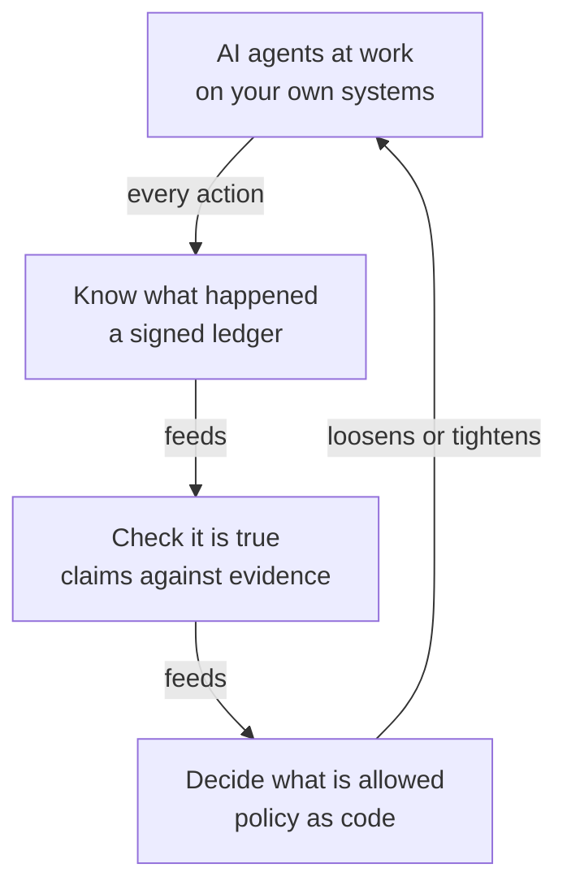

<picture>
  <source media="(prefers-color-scheme: dark)" srcset="lockup-horizontal-color-dark.svg">
  
</picture>

### The trust record of what AI agents do

**Let your agents do more. Know what they did, check that it is true, decide what they may do next.**

---

Agents now open pull requests, change infrastructure and touch production faster than any one person can follow. Nothing they do is hidden; there is just too much of it to see. provesAId keeps the record.

*Knowing, checking, deciding. The loop lets a team remove barriers with evidence instead of adding them out of fear.*

| Question | What answers it |
|---|---|
| Which agent did what, to which system, with whose approval? | the action ledger and its provenance |
| Did it do what it said it did? | each claim checked against the evidence it left |
| Where may an agent act alone, and where does a person review? | policy as code, and a review tier per change |

Evidence is signed and self-contained, so it can be checked outside the product.

**Built for** security teams who sign off on how agents work, and the engineers who run agents on infrastructure, clusters, cloud and SaaS every day.

*In development. The name says the mechanism: prove what was said.*

